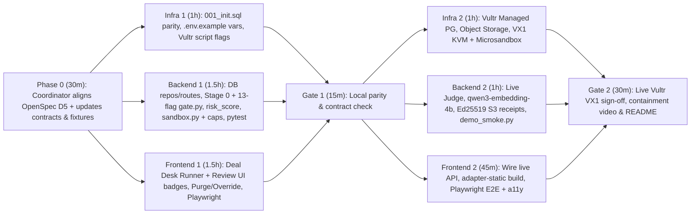

# Execution Plan

Single canonical build schedule and multi-agent blueprint for [Memory Quarantine for AI Agents](Project%20Idea.md) (built for [Hackathon Brief.md](Hackathon%20Brief.md) and detailed in [Exploit Plan.md](Exploit%20Plan.md)), structured so three parallel tracks (`infra/`, `backend/`, `frontend/`) execute concurrently under one shared root OpenSpec record and frozen contracts.

## Pre-flight setup (T=0)

- Provision Vultr Managed PostgreSQL with `pgvector` enabled (`001_init.sql` grants `USAGE ON SCHEMA public` for PG 14+ and creates `quarantine_proxy` and read-only `memory_reader` roles).
- Create a Vultr Object Storage bucket (`quarantine-receipts`) and S3 access keys (`https://<region>.vultrobjects.com`) for Ed25519 cleanup receipts.
- Configure Vultr Serverless Inference (`https://api.vultrinference.com/v1`, OpenAI SDK compatible): verify live model IDs at `/v1/models` for worker/judge (`qwen3.8-27b`, fallback `qwen3.8-flash-next:free`) and embeddings (`qwen3-embedding-4b`, `dimensions=1024`).
- Provision a single Vultr VX1 Ubuntu 24.04 Cloud Compute VM with `/dev/kvm` for Microsandbox (`msb doctor` green; hardened Docker container fallback `--memory=512m --cpus=1` if KVM is unavailable) and FastAPI serving the built SvelteKit `adapter-static` UI (`/` redirects to `/ui`); generate an Ed25519 signing keypair and set `HOST_SECRET` and `REVIEWER_TOKEN`.

## Locked architecture & Vultr stack

| Layer | Locked Choice | Key Vultr & Security Invariants |
| :--- | :--- | :--- |
| **Workspace record** | Single shared root `.agents/context/` + OpenSpec (`openspec/specs/`, `openspec/changes/`) | Scoped `AGENTS.md` in `infra/`, `backend/`, `frontend/`; zero duplicate state files |
| **Database (`infra/` + `backend/`)** | **Option B**: Separate `memories` (active only) + `quarantine_queue` (quarantined/purged/overridden) + `sessions` + `audit_events` | Eliminates `pgvector` filtered-HNSW recall drops; `memory_reader` has `SELECT` only on `memories`; `Purge` wipes `content` to `NULL` while retaining `payload_hash` and `embedding vector(1024)` for known-poison similarity |
| **Backend (`backend/`)** | Python 3.12 + `uv` + FastAPI + `psycopg` (v3 async) + `pgvector` + `openai` SDK + `boto3` + `cryptography` (Ed25519) + `microsandbox` Python SDK (Docker container fallback) | `app/gate.py` is 100% pure deterministic Python (zero I/O, zero LLM calls); host mints `X-Session-Token` via `POST /proxy/sessions` so sandboxes cannot forge `session_id` or `source='user'`; `POST /demo/run` dispatches **Pattern A (Sandboxed Code Execution)** Deal Desk Python tasks with `512MB` RAM, `1` CPU, `30s` timeout caps and stderr retry; `gate_mode=naive` gated behind `DEMO_ALLOW_NAIVE=true` + `X-Reviewer-Token` |
| **Models (`backend/`)** | Isolated judge `qwen3.8-27b` (`qwen3.8-flash-next:free` dev fallback); embeddings `qwen3-embedding-4b` (`dimensions=1024`, `input_type=search_document\|search_query`) | Single judge (no Jev or super judge); judge receives session-bundled writes + provenance + `rule_flags` + `risk_score` (never raw transcripts); thinking arrives in `message.reasoning`; parse/timeout failures fail closed to `FAIL_CLOSED` |
| **Frontend (`frontend/`)** | SvelteKit (Svelte 5) + `pnpm` + `@sveltejs/adapter-static` + Ark UI (`@ark-ui/svelte` on Zag.js) + Tailwind CSS v4 + `@lucide/svelte` + Svelte built-in motion + **Acme** design system + Terrazzo + ESLint 10 (`eslint-plugin-svelte`) + Prettier + `svelte-check` + Vitest + `@vitest/browser-playwright` + Playwright | Includes **"Run Deal Desk Agent"** tab (`POST /demo/run`, `GET /demo/runs` showing stdout/stderr, quote output, and containment event) + **Quarantine Review Console** (`/ui`); browser verifies Ed25519 receipts via Web Crypto against `GET /keys/public` |
| **Hosting & local parity (`infra/`)** | Single Vultr VX1 Ubuntu 24.04 VM (FastAPI serves built `frontend/build` + `/` redirect + host KVM Microsandbox); local `docker-compose.yml` (`pgvector/pgvector:pg16` + MinIO S3) + idempotent setup scripts + `backend/scripts/demo_smoke.py` | Zero separate frontend server; Microsandbox enforces `SANDBOX_MAX_MEMORY_MB=512`, `SANDBOX_MAX_CPUS=1`, `SANDBOX_TIMEOUT_S=30` and blocks sibling microVM traffic and direct DB/S3/internet egress (`test_egress.py`) |

## Seven hackathon safeguards (Brief-Aligned)

1. **Host-minted `X-Session-Token` auth on `/proxy/*`:** `POST /proxy/sessions` mints `session_id` + opaque `session_token` (stored hashed in `sessions.token_hash`). Sandboxes cannot forge or replay another session's ID or claim `source='user'`.
2. **Sandbox egress isolation & resource caps (`test_egress.py`, `test_sandbox_limits.py`):** Every sandbox run has zero DB/S3/LLM API keys, enforces `512MB` RAM, `1` CPU, and `30s` execution timeout, blocks direct connections to Postgres (`5432`), MinIO/Object Storage (`9000`), and external hosts, and is destroyed after each task.
3. **Pattern A Deal Desk execution (`POST /demo/run`, `GET /demo/runs`):** Fulfills the hackathon's web-based code-execution pattern: user triggers a Deal Desk run in `/ui`, LLM writes Python inside the sandbox (with stderr retry) to parse prospect inputs and compute a quote/CSV summary, while memory reads/writes route through `/proxy/*`.
4. **Purged tombstone embeddings preserved:** `Purge` sets `quarantine_queue.content = NULL` and `status = 'purged'`, while keeping `payload_hash` and `embedding vector(1024)` so future `pgvector` cosine-similarity checks auto-block repeats (`poison_similarity`).
5. **Session-bundled judge & one-way escalation:** The isolated judge receives all writes from the same `session_id` in chronological order plus provenance, `rule_flags`, and deterministic `risk_score` (`0-100`). Code always wins on safety: the judge only explains or raises review priority (`+15` sort boost), never downgrading `BLOCKED`, `FAIL_CLOSED`, or `NEEDS_REVIEW` into `ALLOW`.
6. **Explicit `gate_mode=naive` guardrail:** Allowed only when `DEMO_ALLOW_NAIVE=true` and `X-Reviewer-Token` is sent, and always logged to `audit_events` for the teammate's `honeypot/` + `eval.py` comparison.
7. **Browser-side Ed25519 receipt verification & PerMIT hash check:** `GET /keys/public` exposes the Ed25519 public key for Web Crypto verification; `override` promotion and `GET /proxy/memory/active` verify `sha256(utf8(content)) == payload_hash`.

## Multi-agent ownership matrix

Root contracts freeze in Phase 0. Each worker agent writes strictly inside its owned folder to guarantee zero merge conflicts.

| Owner | Directory | Owns | Read-Only Inputs | Never Edits |
| :--- | :--- | :--- | :--- | :--- |
| **Coordinator** | `/`, `contracts/`, `.agents/context/`, `openspec/` | `README.md`, `AGENTS.md`, `CODE.md`, `STATE.md`, `DECISIONS.md`, `SPECS.md`, `LEARNINGS.md`, `openspec/specs/`, `contracts/schema.sql`, `contracts/openapi.yaml`, `contracts/receipt.schema.json`, `contracts/judge.schema.json`, `contracts/fixtures/` | Track check outputs | Track internals during active phases |
| **Infra Agent** | `infra/` | `docker-compose.yml` (PG16+pgvector, MinIO), `sql/001_init.sql`, `scripts/keygen_ed25519.py`, `scripts/setup_vultr_vx1.sh`, `scripts/vultr_provision.sh`, `scripts/smoke_check.py`, `scripts/reset_demo.py`, `.env.example`, `AGENTS.md` | `contracts/schema.sql` | `backend/`, `frontend/` |
| **Backend Agent** | `backend/` | `pyproject.toml` (`uv`), FastAPI Memory Proxy, sticky taint tracker, pure Stage 0 + 13-flag deterministic gate (`app/gate.py`), `risk_score`, `pgvector` poison similarity (`qwen3-embedding-4b`), isolated judge (`app/judge.py`, `qwen3.8-27b`), Pattern A sandbox runner (`app/sandbox.py` + `POST /demo/run`, `GET /demo/runs`), SHA-256 `audit_events` chain (`app/audit.py`), Ed25519 signer + S3 uploader (`app/receipts.py`), static UI mount + `/` redirect, `pytest` suite (`test_gate.py`, `test_egress.py`, `test_sandbox_limits.py`), `scripts/demo_smoke.py`, `AGENTS.md` | `contracts/*`, `infra/.env.example` | `frontend/`, `infra/` |
| **Frontend Agent** | `frontend/` | SvelteKit 5 + `adapter-static` Deal Desk & Quarantine Review UI on Acme tokens + Ark UI + Tailwind v4: `"Run Deal Desk Agent"` runner view (`POST /demo/run`, `GET /demo/runs` stdout/stderr + quote output), session-grouped queue sorted by `(risk_score + judge_boost, created_at DESC)`, `"Evaluating..."` pending state, verdict/rule-flag badges, raw source preview, judge JSON panel, `Purge`/`Override` (`X-Reviewer-Token` + required typed reason for `BLOCKED` and `FAIL_CLOSED`), SHA-256 audit chain viewer, Web Crypto Ed25519 receipt verifier, mock API adapter, Vitest + Vitest Browser Mode + Playwright tests | `contracts/openapi.yaml`, `contracts/receipt.schema.json`, `contracts/fixtures/*` | `backend/`, `infra/` |
| **Teammate (Honeypot)** | `honeypot/` | Deal Desk simulation (seeded poisoned emails/web pages, canary floor-pricing docs, fake `send_email` sink, 16-case `eval.py` comparing `gate_mode=naive` vs `quarantined`) | Proxy HTTP API (`/proxy/*`) | `contracts/`, `backend/`, `infra/`, `frontend/` |

## Build phases & sync gates (Target: before 19:00 deadline)



### Detailed Phase & Gate Checklists

* **Phase 0 (Coordinator, 30 min):** Apply OpenSpec change (`D5`) updating `openspec/specs/` (`memory-gate`, `quarantine-review`), `contracts/` (`schema.sql`, `openapi.yaml`, `receipt.schema.json`, `judge.schema.json`, `README.md`, `fixtures/generate.mjs`) for `ALLOW`/`NEEDS_REVIEW`/`BLOCKED`/`FAIL_CLOSED`, `risk_score`, `immediate_write_after_read`, `FAIL_CLOSED > BLOCKED` pre-freeze precedence, and `/demo/run` + `/demo/runs` schemas; regenerate fixtures; verify `contracts/check_contracts.py` and `record_check.mjs`.
* **Phase 1 (Parallel 1.5h):**
  * **Infra:** Sync `sql/001_init.sql` with `contracts/schema.sql`, add `S3_REGION=us-east-1`, `ALLOWLISTED_DOMAINS`, `CANARY_TOKENS`, `POISON_SIMILARITY_THRESHOLD=0.85`, `EMBEDDING_FAIL_CLOSED=false`, and `SANDBOX_MAX_MEMORY_MB=512` / `SANDBOX_MAX_CPUS=1` / `SANDBOX_TIMEOUT_S=30` to `.env.example`, and replace placeholders in `vultr_provision.sh`.
  * **Backend:** Wire `psycopg` DB repositories (`sessions`, `memories`, `quarantine_queue`, `audit_events`) so `/proxy/*`, `/quarantine*`, `/audit` replace `501` stubs; update `app/models.py` + `app/gate.py` (Stage 0 zero-width/bidi stripping, 13 flags, `risk_score`, `FAIL_CLOSED > BLOCKED` pre-freeze precedence, IP-literal check); add `JUDGE_MODEL_FALLBACK` in `app/config.py`; implement `app/sandbox.py` (`microsandbox` SDK + Docker fallback with CPU/RAM/timeout caps, stderr retry, `POST /demo/run`, `GET /demo/runs`, `/` -> `/ui` redirect); pass `pytest` (`test_gate.py`, `test_egress.py`, `test_sandbox_limits.py`) and `ruff`.
  * **Frontend:** Implement Deal Desk Runner tab (`/demo/run`, `/demo/runs` output/stderr) + Review UI badges (`ALLOW`/`NEEDS_REVIEW`/`BLOCKED`/`FAIL_CLOSED`), separate `source` origin chip, `(risk_score + judge_boost, created_at DESC)` sorting, `"Evaluating..."` state, `Purge`/`Override` with required typed reason on `BLOCKED` and `FAIL_CLOSED`, receipt modal, and `check:unified`.
* **Gate 1 (Local Parity, 15 min):** `cd backend && uv run pytest -q` passes against local Docker PG + MinIO; `cd frontend && pnpm run check:unified` passes against fixtures; `source` cannot be spoofed; tainted writes freeze (`HTTP 202`); `test_egress.py` and `test_sandbox_limits.py` pass.
* **Phase 2 (Parallel 1h):**
  * **Infra:** Provisions Vultr Managed PostgreSQL (`pgvector`), Vultr Object Storage bucket + keys, Vultr VX1 Ubuntu 24.04 (`msb doctor` green on `/dev/kvm`, or Docker fallback verified), applies `001_init.sql`, verifies public HTTPS/firewall ingress.
  * **Backend:** Wires live Vultr Serverless Inference (`qwen3.8-27b` isolated judge + `qwen3-embedding-4b` 1024 dims + `qwen3.8-flash-next:free` fallback), Ed25519 receipt upload to Vultr Object Storage via `boto3`, static UI serving, and `backend/scripts/demo_smoke.py`.
  * **Frontend:** Switches from fixtures to live FastAPI backend, builds `adapter-static` output, runs Playwright E2E + axe a11y checks against the live Review UI.
* **Gate 2 (Live Vultr VX1 Sign-Off & Demo Video, 30 min):** `demo_smoke.py` passes on live Vultr stack; teammate's `honeypot/eval.py` logs before-and-after leak rates; root `README.md` is updated with public URL + setup instructions; record demo video showing **one containment moment** (sandbox absorbing unsafe egress/loop under resource caps + Memory Proxy freezing poisoned Session 1 write, human purge in `/ui` with Ed25519 receipt, clean Session 2 Python quote execution).

## Target Contracts (Pending OpenSpec `D5`)

### Database schema (`contracts/schema.sql`, Option B, `vector(1024)`)

- **Extension & roles**: `CREATE EXTENSION IF NOT EXISTS vector;` + `GRANT USAGE ON SCHEMA public TO quarantine_proxy, memory_reader;` + `GRANT SELECT ON TABLE memories TO memory_reader;` (no access to `quarantine_queue`).
- **`sessions`**: `id (uuid PK)`, `token_hash (text unique not null)`, `gate_mode (text: 'quarantined' | 'naive')`, `tainted (bool default false)`, `external_sources (jsonb default '[]')`, `write_count (int default 0)`, `writes_since_last_read (int default 0)`, `created_at (timestamptz)`.
- **`memories` (active recall only)**: `id (uuid PK)`, `session_id (uuid FK)`, `content (text not null)`, `source (text: 'user' | 'external_override')`, `source_ref (text)`, `payload_hash (text not null)`, `embedding (vector(1024))`, `promoted_from_quarantine_id (uuid nullable)`, `created_at (timestamptz)` + HNSW cosine index (`vector_cosine_ops`).
- **`quarantine_queue`**: `id (uuid PK)`, `session_id (uuid FK)`, `status (text: 'quarantined' | 'purged' | 'overridden')`, `content (text nullable -- wiped to NULL on purge)`, `payload_hash (text not null)`, `embedding (vector(1024) -- retained on purge for poison similarity)`, `source (text not null)`, `source_ref (text)`, `verdict (text: 'NEEDS_REVIEW' | 'BLOCKED' | 'FAIL_CLOSED')`, `risk_score (integer not null default 0 check 0..100)`, `rule_flags (jsonb not null default '[]')`, `judge_status (text: 'pending' | 'done' | 'failed')`, `judge_note (jsonb nullable)`, `override_reason (text nullable)`, `decided_by (text nullable)`, `decided_at (timestamptz nullable)`, `receipt_uri (text nullable)`, `created_at (timestamptz)` + partial HNSW cosine index `WHERE status = 'purged' AND embedding IS NOT NULL`.
- **`audit_events` (append-only SHA-256 chain)**: `seq (bigserial PK)`, `session_id (uuid)`, `event_type (text not null)`, `target_id (uuid nullable)`, `payload (jsonb not null)`, `prev_hash (text not null)`, `event_hash (text not null)`, `created_at (timestamptz)`.

### REST API surface (`contracts/openapi.yaml`)

| Endpoint | Auth | Purpose |
| :--- | :--- | :--- |
| `GET /` | Public | Redirects to `/ui` (public web app entry point) |
| `GET /health` | Public | DB + Object Storage + Inference + Sandbox readiness check |
| `POST /demo/run` | `X-Reviewer-Token` | Dispatches a Pattern A Deal Desk Python task inside a capped sandbox (`512MB`, `1` CPU, `30s`) with stderr retry |
| `GET /demo/runs` | Public / Reviewer | Lists recent sandboxed runs, stdout/stderr logs, quote output, and containment outcomes |
| `POST /proxy/sessions` | `X-Host-Secret` | Host mints `session_id` + opaque `session_token` |
| `POST /proxy/read` | `X-Session-Token` | Registers/fetches external content; sets `sessions.tainted = true` + resets `writes_since_last_read = 0` |
| `POST /proxy/memory/write` | `X-Session-Token` | Runs pure Stage 0 + 13-flag deterministic gate + `qwen3-embedding-4b` poison check; `201` if `ALLOW`, `202` if frozen |
| `GET /proxy/memory/active` | `X-Session-Token` | Queries ONLY `memories` via `memory_reader` role (`pgvector` cosine `<=>`), verifying `payload_hash` |
| `GET /quarantine` | `X-Reviewer-Token` | Lists quarantine rows grouped by `session_id`, sorted by `(risk_score + judge_boost, created_at DESC)` |
| `POST /quarantine/{id}/decide` | `X-Reviewer-Token` | Body: `{action: "purge" \| "override", reason?: string}`; requires non-empty `reason` on `BLOCKED` or `FAIL_CLOSED` override; signs & uploads Ed25519 receipt |
| `GET /audit` | `X-Reviewer-Token` | Returns hash-chained `audit_events` + server-computed `chain_valid: boolean` |
| `GET /keys/public` | Public | Returns Ed25519 public key (base64 + JWK) for browser Web Crypto verification |
| `GET /receipts/{id}` | `X-Reviewer-Token` | Fetches signed receipt JSON + signature from Vultr Object Storage / MinIO |

### Strict judge JSON schema (`qwen3.8-27b`, `contracts/judge.schema.json`)

```json
{
  "summary": "One-sentence factual summary of the proposed memory write in session context.",
  "risk_level": "low | medium | high | critical",
  "recommended_action": "purge | override",
  "indicators": ["imperative forwarding directive", "non-allowlisted external domain"]
}
```

Parse error, invalid enum, or timeout sets `judge_status = "failed"`, appends `judge_failed` to `rule_flags` and `audit_events`, escalates `NEEDS_REVIEW` -> `FAIL_CLOSED`, and keeps `BLOCKED` unchanged.

### Signed receipt schema (`contracts/receipt.schema.json`)

Canonical JSON (sorted keys, UTF-8, compact separators, zero floats) signed with Ed25519 at `Purge`/`Override` time:

```json
{
  "receipt_id": "uuid",
  "event": "purged | overridden",
  "quarantine_id": "uuid",
  "session_id": "uuid",
  "verdict": "BLOCKED",
  "risk_score": 100,
  "rule_flags": ["tainted_session", "imperative_directive", "external_email"],
  "payload_hash": "sha256:...",
  "audit_head_hash": "sha256:...",
  "override_reason": null,
  "timestamp": "2026-11-27T10:00:00Z",
  "key_id": "...",
  "signature_alg": "Ed25519",
  "signature_b64": "..."
}
```

## Out of scope and future work

- Honeypot Deal Desk simulation (`honeypot/`, fake `send_email` sink, canary floor-pricing docs, and 16-case `eval.py` sweep: owned by a separate teammate against `/proxy/*`).
- Deferred detectors (add if `eval.py` shows tainted-session misses): `stealth_suppression`, `delimiter_spoof`, homoglyph/Base64 decoding, `markdown_ref_link`, `authority_laundering`, and `salami_cluster`.
- Multi-role RBAC, SSO, and Slack or PagerDuty approval webhooks (first build uses one `REVIEWER_TOKEN`).
- File-backed `MEMORY.md` diff stripping for agents such as Hermes Agent and OpenClaw (first build targets Managed PostgreSQL).
- Trained classifiers (`SBERT+LR` or `SetFit` from MemSentry) and dependency-DAG blast-radius scoring.
- Cross-user community endorsement and auto-promotion (from PerMIT).
