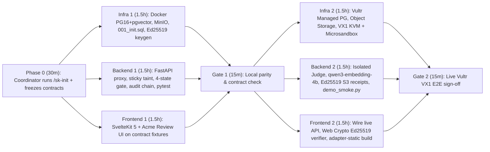

# Proposed plan

Build schedule and multi-agent execution blueprint for [Memory quarantine for AI agents](Project%20Idea.md) (built for [Hackathon Brief](Hackathon%20Brief.md)), structured so three parallel tracks (`infra/`, `backend/`, `frontend/`) can execute concurrently under one shared root OpenSpec record and frozen Phase 0 contracts.

## Pre-flight setup (T=0)

- Provision Vultr Managed PostgreSQL with `pgvector` enabled (`001_init.sql` grants `USAGE ON SCHEMA public` for PG 14+ and creates `quarantine_proxy` and read-only `memory_reader` roles).
- Create a Vultr Object Storage bucket (`quarantine-receipts`) and S3 access keys (`https://<region>.vultrobjects.com`) for Ed25519 cleanup receipts.
- Configure Vultr Serverless Inference (`https://api.vultrinference.com/v1`, OpenAI SDK compatible): isolated judge `qwen3.8-27b` (free dev fallback `qwen3.8-flash-next:free`) and embeddings `qwen3-embedding-4b` (`dimensions=1024`).
- Provision a single Vultr VX1 Ubuntu 24.04 Cloud Compute VM with `/dev/kvm` for Microsandbox (`msb doctor` green) and FastAPI serving the built SvelteKit `adapter-static` UI; generate an Ed25519 signing keypair and set `HOST_SECRET` and `REVIEWER_TOKEN`.

## Locked architecture & Vultr stack

| Layer | Locked Choice | Key Vultr & Security Invariants |
| :--- | :--- | :--- |
| **Workspace record** | Single shared root `.agents/context/` + OpenSpec (`openspec/specs/`, `openspec/changes/`) | Scoped `AGENTS.md` in `infra/`, `backend/`, `frontend/`; zero duplicate state files |
| **Database (`infra/` + `backend/`)** | **Option B**: Separate `memories` (active only) + `quarantine_queue` (quarantined/purged/overridden) + `sessions` + `audit_events` | Eliminates `pgvector` filtered-HNSW recall drops; `memory_reader` has `SELECT` only on `memories`; `Purge` wipes `content` to `NULL` while retaining `payload_hash` and `embedding vector(1024)` for known-poison similarity |
| **Backend (`backend/`)** | Python 3.12 + `uv` + FastAPI + `psycopg` (v3 async) + `pgvector` + `openai` SDK + `boto3` + `cryptography` (Ed25519) + `microsandbox` Python SDK | Host mints `X-Session-Token` via `POST /proxy/sessions` so sandboxes cannot forge `session_id` or `source='user'`; `gate_mode=naive` gated behind `DEMO_ALLOW_NAIVE=true` + `X-Reviewer-Token` and logged to `audit_events` |
| **Models (`backend/`)** | Isolated judge `qwen3.8-27b` (`qwen3.8-flash-next:free` dev fallback); embeddings `qwen3-embedding-4b` (`dimensions=1024`, `input_type=search_document\|search_query`) | Judge receives session-bundled writes (catches split-write attacks) + provenance + rule flags only (never raw transcripts); thinking arrives in `message.reasoning`; parse/timeout failures fail closed to `INCONCLUSIVE` |
| **Frontend (`frontend/`)** | SvelteKit (Svelte 5) + `pnpm` + `@sveltejs/adapter-static` + Ark UI (`@ark-ui/svelte` on Zag.js) + Tailwind CSS v4 + `@lucide/svelte` + Svelte built-in motion + **Acme** design system (`acme.zip`) + Terrazzo + ESLint 10 (`eslint-plugin-svelte`) + Prettier + `svelte-check` + Vitest + `@vitest/browser-playwright` + Playwright | Uses Acme tokens (`#00884a`, Geist / Geist Mono, soft 4/8/12px radii, comfortable density, `DESIGN.md`, `tokens.css`, `theme.css`, `tokens.json`); browser verifies Ed25519 receipts via Web Crypto against `GET /keys/public` |
| **Hosting & local parity (`infra/`)** | Single Vultr VX1 Ubuntu 24.04 VM (FastAPI serves built `frontend/build` + host KVM Microsandbox); local `docker-compose.yml` (`pgvector/pgvector:pg16` + MinIO S3) + idempotent setup scripts + `backend/scripts/demo_smoke.py` | Zero separate frontend server; Microsandbox blocks sibling microVM traffic by default |

## Multi-agent ownership matrix

Root contracts freeze in Phase 0. Each worker agent writes strictly inside its owned folder to guarantee zero merge conflicts.

| Owner | Directory | Owns | Read-Only Inputs | Never Edits |
| :--- | :--- | :--- | :--- | :--- |
| **Coordinator** | `/`, `contracts/`, `.agents/context/`, `openspec/` | `AGENTS.md`, `CODE.md`, `STATE.md`, `DECISIONS.md`, `SPECS.md`, `LEARNINGS.md`, `openspec/specs/`, `contracts/schema.sql`, `contracts/openapi.yaml`, `contracts/receipt.schema.json`, `contracts/fixtures/` | Track check outputs | Track internals during active phases |
| **Infra Agent** | `infra/` | `docker-compose.yml` (PG16+pgvector, MinIO), `sql/001_init.sql`, `scripts/keygen_ed25519.py`, `scripts/setup_vultr_vx1.sh`, `scripts/vultr_provision.sh`, `scripts/smoke_check.py`, `scripts/reset_demo.py`, `.env.example`, `AGENTS.md` | `contracts/schema.sql` | `backend/`, `frontend/` |
| **Backend Agent** | `backend/` | `pyproject.toml` (`uv`), FastAPI Memory Proxy, sticky taint tracker, 4-state deterministic gate (`gate.py`), `pgvector` poison similarity, isolated judge (`judge.py`), SHA-256 `audit_events` chain (`audit.py`), Ed25519 signer + S3 uploader (`receipts.py`), static UI mount, `pytest` suite, `scripts/demo_smoke.py`, `AGENTS.md` | `contracts/*`, `infra/.env.example` | `frontend/`, `infra/` |
| **Frontend Agent** | `frontend/` | SvelteKit 5 + `adapter-static` Quarantine Review UI on Acme tokens + Ark UI + Tailwind v4: session-grouped queue, raw source preview, rule flag badges, judge JSON panel, `Purge`/`Override` (`X-Reviewer-Token` + required typed reason for `POLICY_BLOCKED`), SHA-256 audit chain viewer, Web Crypto Ed25519 receipt verifier, mock API adapter, Vitest + Vitest Browser Mode + Playwright tests | `contracts/openapi.yaml`, `contracts/receipt.schema.json`, `contracts/fixtures/*` | `backend/`, `infra/` |

## Build phases & sync gates (Total: ~4h)



| Phase | Target time | Track | Deliverable | Done check |
| :--- | :--- | :--- | :--- | :--- |
| 0 | 30m | Coordinator | `/sk-init` root (OpenSpec) + `frontend/` (SvelteKit 5, Ark UI `@ark-ui/svelte`, Acme tokens from `acme.zip`, ESLint + `eslint-plugin-svelte`, Vitest/Playwright, `adapter-static`), scoped `backend/` & `infra/` `AGENTS.md`, frozen `contracts/` (`schema.sql`, `openapi.yaml`, `receipt.schema.json`, fixtures) | All 3 agents can start in parallel with zero unresolved schemas |
| 1 | 1.5h | Infra, Backend, Frontend (parallel) | **Infra**: Docker PG16+pgvector + MinIO + `001_init.sql` + Ed25519 keygen; **Backend**: FastAPI proxy (`/proxy/*`, `/quarantine/*`, `/audit`, `/keys/public`, `/receipts/{id}`), sticky taint, 4-state gate, SHA-256 chain; **Frontend**: Complete Review UI against `contracts/fixtures/` | **Gate 1 (15m)**: `uv run pytest` passes against local Postgres/MinIO; `pnpm run check` passes against fixtures; `source` cannot be spoofed and tainted writes freeze (`HTTP 202`) |
| 2 | 1.5h | Infra, Backend, Frontend (parallel) | **Infra**: Live Vultr Managed PG, Object Storage, VX1 Ubuntu 24.04 (`msb doctor` green); **Backend**: Live `qwen3.8-27b` isolated judge, `qwen3-embedding-4b` (1024 dims), Ed25519 `boto3` receipt upload, static UI mount, `demo_smoke.py`; **Frontend**: Live API wiring, Web Crypto Ed25519 verification, `adapter-static` build, Playwright E2E + axe a11y | **Gate 2 (15m)**: `demo_smoke.py` passes on live Vultr stack; reviewer purges poisoned row in UI, verifies Ed25519 receipt in browser, and confirms clean `GET /proxy/memory/active` |

## Frozen Phase 0 contracts

### Database schema (`contracts/schema.sql`, Option B, `vector(1024)`)

- **Extension & roles**: `CREATE EXTENSION IF NOT EXISTS vector;` + `GRANT USAGE ON SCHEMA public TO quarantine_proxy, memory_reader;` + `GRANT SELECT ON TABLE memories TO memory_reader;` (no access to `quarantine_queue`).
- **`sessions`**: `id (uuid PK)`, `token_hash (text unique not null)`, `gate_mode (text: 'quarantined' | 'naive')`, `tainted (bool default false)`, `external_sources (jsonb default '[]')`, `write_count (int default 0)`, `created_at (timestamptz)`.
- **`memories` (active recall only)**: `id (uuid PK)`, `session_id (uuid FK)`, `content (text not null)`, `source (text: 'user' | 'external_override')`, `source_ref (text)`, `payload_hash (text not null)`, `embedding (vector(1024))`, `promoted_from_quarantine_id (uuid nullable)`, `created_at (timestamptz)` + HNSW cosine index (`vector_cosine_ops`).
- **`quarantine_queue`**: `id (uuid PK)`, `session_id (uuid FK)`, `status (text: 'quarantined' | 'purged' | 'overridden')`, `content (text nullable -- wiped to NULL on purge)`, `payload_hash (text not null)`, `embedding (vector(1024) -- retained on purge for poison similarity)`, `source (text not null)`, `source_ref (text)`, `verdict (text: 'TAINTED_UNREVIEWED' | 'POLICY_BLOCKED' | 'INCONCLUSIVE')`, `rule_flags (jsonb not null default '[]')`, `judge_status (text: 'pending' | 'done' | 'failed')`, `judge_note (jsonb nullable)`, `override_reason (text nullable)`, `decided_by (text nullable)`, `decided_at (timestamptz nullable)`, `receipt_uri (text nullable)`, `created_at (timestamptz)` + partial HNSW cosine index `WHERE status = 'purged' AND embedding IS NOT NULL`.
- **`audit_events` (append-only SHA-256 chain)**: `seq (bigserial PK)`, `session_id (uuid)`, `event_type (text not null)`, `target_id (uuid nullable)`, `payload (jsonb not null)`, `prev_hash (text not null)`, `event_hash (text not null)`, `created_at (timestamptz)`.

### REST API surface (`contracts/openapi.yaml`)

| Endpoint | Auth | Purpose |
| :--- | :--- | :--- |
| `GET /health` | Public | DB + Object Storage + Inference readiness check |
| `POST /proxy/sessions` | `X-Host-Secret` | Host mints `session_id` + opaque `session_token` |
| `POST /proxy/read` | `X-Session-Token` | Registers/fetches external content; sets `sessions.tainted = true` + logs `source_ref` |
| `POST /proxy/memory/write` | `X-Session-Token` | Runs deterministic 4-state gate + `qwen3-embedding-4b` (1024 dims) poison check; `201` if `CLEAN_USER`, `202` if frozen |
| `GET /proxy/memory/active` | `X-Session-Token` | Queries ONLY `memories` via `memory_reader` role (`pgvector` cosine `<=>`) |
| `GET /quarantine` | `X-Reviewer-Token` | Lists quarantine rows grouped by `session_id` with source snippets, rule flags, judge JSON, and receipt URIs |
| `POST /quarantine/{id}/decide` | `X-Reviewer-Token` | Body: `{action: "purge" \| "override", reason?: string}`; requires non-empty `reason` on `POLICY_BLOCKED` override; signs & uploads Ed25519 receipt |
| `GET /audit` | `X-Reviewer-Token` | Returns hash-chained `audit_events` + server-computed `chain_valid: boolean` |
| `GET /keys/public` | Public | Returns Ed25519 public key (base64 + JWK) for browser Web Crypto verification |
| `GET /receipts/{id}` | `X-Reviewer-Token` | Fetches signed receipt JSON + signature from Vultr Object Storage / MinIO |

### Strict judge JSON schema (`qwen3.8-27b`)

```json
{
  "summary": "One-sentence factual summary of the proposed memory write in session context.",
  "risk_level": "low | medium | high | critical",
  "recommended_action": "purge | override",
  "indicators": ["imperative forwarding directive", "non-allowlisted external domain"]
}
```

Parse error, invalid enum, or timeout sets `judge_status = "failed"` and forces `verdict = "INCONCLUSIVE"` (fail closed).

### Signed receipt schema (`contracts/receipt.schema.json`)

Canonical JSON (sorted keys, UTF-8, compact separators) signed with Ed25519:

```json
{
  "receipt_id": "uuid",
  "event": "quarantined | purged | overridden",
  "quarantine_id": "uuid",
  "session_id": "uuid",
  "verdict": "POLICY_BLOCKED",
  "rule_flags": ["imperative_directive", "external_email"],
  "payload_hash": "sha256:...",
  "audit_head_hash": "sha256:...",
  "override_reason": null,
  "timestamp": "2026-11-27T10:00:00Z",
  "signature_alg": "Ed25519",
  "signature_b64": "..."
}
```

## Out of scope and future work

- Honeypot Deal Desk simulation (`honeypot/`, fake `send_email` sink, canary floor-pricing docs, and 16-case `eval.py` sweep: deferred; current build verifies containment via `backend/scripts/demo_smoke.py` and `pytest`).
- Multi-role RBAC, SSO, and Slack or PagerDuty approval webhooks (first build uses one `REVIEWER_TOKEN`).
- File-backed `MEMORY.md` diff stripping for agents such as Hermes Agent and OpenClaw (first build targets Managed PostgreSQL).
- Trained classifiers (`SBERT+LR` or `SetFit` from MemSentry) and dependency-DAG blast-radius scoring.
- Cross-user community endorsement and auto-promotion (from PerMIT).
- Same-session egress sandboxing, legacy DB/RAG/tool/skill scanning, and 50+ case multi-run sweeps.
